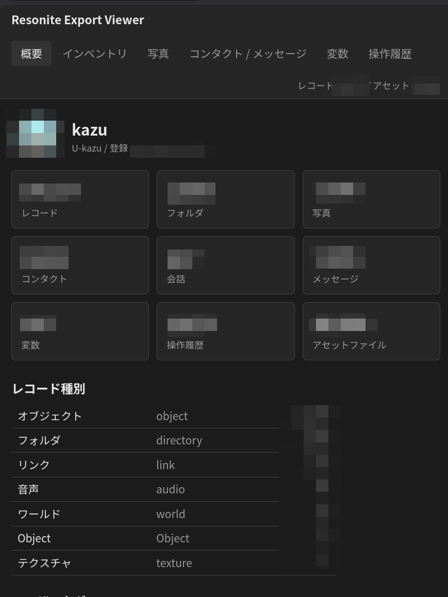

# Resonite Account Export Tools

[Resonite Account Downloader](https://github.com/Yellow-Dog-Man/ResoniteAccountDownloader) でダウンロードしたアカウントデータを閲覧・整理するためのツール。

- **resonite_viewer.py** - ダウンロードしたデータ全体 (インベントリ・写真・メッセージ・コンタクトなど) をブラウザで一覧できるローカルビューア
- **rebuild_photos.py** - インベントリの写真フォルダ構造を、そのまま画像ファイルとして書き出すスクリプト

Python 3.8 以上の標準ライブラリのみで動作し、追加インストールは不要 (Linux / Windows / macOS)。

## resonite_viewer.py

ダウンロードしたアカウントデータを閲覧できる。



### クイックスタート

1. [Resonite Account Downloader](https://github.com/Yellow-Dog-Man/ResoniteAccountDownloader) の [Releases](https://github.com/Yellow-Dog-Man/ResoniteAccountDownloader/releases) から OS に合った zip を入手して実行し、アカウントデータをダウンロードして `U-xxx/` と `Assets/` を含むフォルダ (例: `ResoniteDownload`) を用意する
2. ビューアを起動する

   ```sh
   # Linux / macOS
   python3 resonite_viewer.py path/to/ResoniteDownload

   # Windows
   py resonite_viewer.py path\to\ResoniteDownload
   ```

3. ブラウザで `http://127.0.0.1:8765/` が自動で開く。終了するときはターミナルで Ctrl+C

### タブ

| タブ | 内容 |
|------|------|
| 概要 | プロフィール、件数、レコード種別、Patreon 支払い履歴、ユーザー情報 |
| インベントリ | フォルダツリーとサムネイル一覧、全体検索、詳細パネル (プレビュー・メタデータ・アセットのダウンロード・生 JSON) |
| 写真 | 全写真を月別に表示。ワールド名・写っている人・年・種類 (通常 / 360 / ステレオ) で絞り込み。矢印キーで前後移動 |
| コンタクト / メッセージ | 会話一覧とチャット表示 (テキスト、ボイス再生、画像、招待) |
| 変数 | クラウド変数の一覧 |
| 操作履歴 | レコードの更新・削除履歴 |

### オプション

| オプション | 説明 |
|-----------|------|
| `--port 8765` | 待ち受けポート (使用中なら次の空きポートを使う) |
| `--no-browser` | ブラウザを自動で開かない |

- フォルダ指定を省略すると、カレントディレクトリかスクリプトと同じ場所の `ResoniteDownload` を探す
- ダウンロードデータに複数のアカウントやグループが含まれる場合は、画面上部で切り替えられる

## rebuild_photos.py

写真をフォルダとして書き出したい場合に利用する。

### クイックスタート

```sh
python3 rebuild_photos.py path/to/ResoniteDownload OUT_DIR
```

### オプション

| オプション | 説明 |
|-----------|------|
| `--folders` | `Inventory` 直下の対象フォルダ名 (既定: `Photos_VR Photos-Root`)。アカウントに合わせて変更する |
| `--dry-run` | ファイルを書き出さず、件数と容量だけ表示する |

### 書き出すファイル

- ファイル名: `YYYY-MM-DD_HHMMSS_<写真名>.<拡張子>` (撮影日時はローカル時刻)。ファイルの更新日時も撮影日時に設定する
- 画像の解決順: `texture_asset` タグ → `assetManifest` 内の最大の画像 → サムネイル (ファイル名に `_thumb` が付く)
- `OUT_DIR/_index.csv` にレコード ID・元パス・出力ファイル・取得元を記録する
- 再実行時は同じサイズの既存ファイルをスキップする
- Windows のパス長制限 (260 文字) を回避して書き出す

## (参考) ダウンロードデータの構造

Resonite Account Downloader の出力フォルダの構造。

```
ResoniteDownload/
├── Assets/            アセット本体 (ファイル名 = SHA-256 ハッシュ)
└── U-xxx/             アカウントごと (グループは G-xxx)
    ├── Records/       インベントリのレコード (フォルダ・アイテム・写真など)
    ├── Contacts/      コンタクト
    ├── Messages/      相手ごとのメッセージ (Messages/<相手のID>/MSG-xxx.json)
    ├── RecordAudit/   レコードの更新・削除履歴
    ├── Variables/     クラウド変数
    └── UserData/      User.json と Patreon/ 支払い履歴
```

### レコードの主なフィールド

| フィールド | 内容 |
|-----------|------|
| `recordType` | `directory` / `object` / `link` / `audio` / `world` など |
| `path`, `name` | インベントリ上の場所と名前 (`Inventory\Photos_VR\2023_6` のように `\` 区切り) |
| `assetUri` | オブジェクト本体 (`resdb:///<hash>.7zbson` / `.brson`) |
| `thumbnailUri` | サムネイル (`resdb:///<hash>.webp`) |
| `assetManifest` | レコードが参照するアセットのハッシュとサイズ |
| `tags` | 写真なら `texture_asset:resdb:///<hash>`、`location_name:`、`timestamp:`、`user:<写っている人のID>` など |

`resdb:///<hash>.<ext>` は `Assets/<hash>` に対応する。

## ライセンス

[0BSD](LICENSE)
